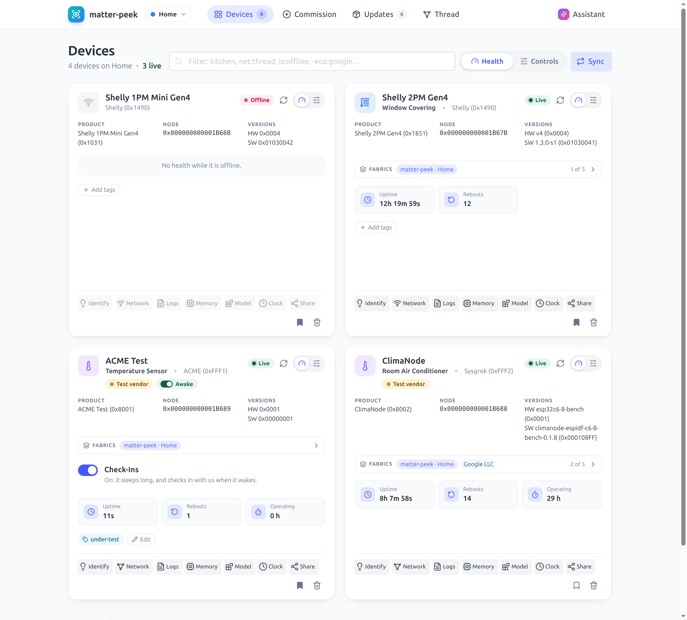

# matter-peek

**A health and diagnostics tool for Matter devices, to use next to your existing controller.**

[](https://github.com/sysgrok/matter-peek/actions/workflows/ci.yml)
[](https://crates.io/crates/matter-peek)
[](#license)
[](https://matrix.to/#/#rs-matter:matrix.org)

When Google Home, Apple Home or Alexa report a device as *not responding*, they usually don't say why.

matter-peek can help you find out.

It is added to your Matter devices as an additional admin, next to the controller you already use, and shows what the devices report about themselves: uptime and reboots, Wi-Fi signal and Thread mesh links, free heap and stack, and crash logs.

It can also commission devices, show and edit their full data model, and update their firmware. Optionally, an AI assistant can look through all of this for you and answer your questions about it.

It runs locally on your network and does not need an account. It is a single self-contained executable, written in Rust and built on [rs-matter](https://github.com/project-chip/rs-matter).

<a href="https://github.com/sysgrok/matter-peek/blob/main/docs/SCREENSHOTS.md">
  <picture>
    <source media="(prefers-color-scheme: dark)" srcset="docs/screenshots/devices-dark.png">
    
  </picture>
</a>

See the [screenshots](https://github.com/sysgrok/matter-peek/blob/main/docs/SCREENSHOTS.md) for more.

## Features

- **Health and logs.** Uptime, reboots, network faults, and heap and stack usage, updated live. Crash and diagnostic logs are retrieved over BDX.
- **Commissioning and sharing.** Commissioning over IP or Bluetooth LE, onto Wi-Fi or Thread. Devices can be added from other ecosystems, or shared with them.
- **Data model.** All clusters, attributes, commands and events, by name and updated live, with controls for common device types.
- **Thread mesh.** A view of the Thread mesh built from Matter data only, without Thread credentials. Problems it detects are described in plain words.
- **OTA updates.** matter-peek acts as the OTA Provider for your devices: upload an image, then start the update.
- **AI.** An MCP server for Claude, Cursor and other MCP clients, and a built-in assistant that works with any OpenAI-compatible model, including local ones.

Other features include [multiple fabrics, network management, a time source and a common filter language](https://github.com/sysgrok/matter-peek/blob/main/docs/GUIDE.md). The web UI, the CLI and the app all use the same API.

## Status

matter-peek is fully usable, but not yet released. It runs on Linux today, and on Android through the app. Planned next:

- `cargo install matter-peek` from crates.io: the names are reserved, but the real crates wait for an rs-matter release that has everything matter-peek uses.
- Pre-built binaries for Linux, Windows and macOS.
- Ready-made apps for Android and iPhone.

Until then, build it from GIT, as below.

> **Note:** the server has no authentication yet. Whoever reaches it controls your devices, so keep `matter-peek serve` on localhost (its default) or behind something that guards it.

## Install

matter-peek consists of two executables:

- **`matter-peek`**: the server with the web UI, the CLI, the MCP server and the terminal chat, in a single file. It also runs on headless machines, such as a Raspberry Pi, a NAS or a container.
- **`matter-peek-app`**: the web UI as a desktop app. It either runs its own controller, or connects to a `matter-peek` server.

Both can be built on Linux (x86_64 or aarch64) with Rust 1.91 or newer. You can use the Rust packaged by your distribution, or install it with [rustup](https://rustup.rs).

```sh
# Option 1: Rust from your distribution (this also installs the C toolchain Rust needs for linking)
sudo apt install cargo                          # Ubuntu 26.04, Debian testing
sudo apt install -t trixie-backports cargo      # Debian 13, Raspberry Pi OS (backports enabled)
sudo apt install cargo-1.91                     # Ubuntu 24.04: then use `cargo-1.91` instead of `cargo`

# Option 2: Rust from rustup
sudo apt install build-essential                # the C toolchain Rust needs for linking
curl --proto '=https' --tlsv1.2 -sSf https://sh.rustup.rs | sh    # then open a new shell
```

**`matter-peek`**

```sh
cargo install --locked --git https://github.com/sysgrok/matter-peek matter-peek
```

**`matter-peek-app`**

```sh
sudo apt install pkg-config libwebkit2gtk-4.1-dev libdbus-1-dev
cargo install --locked --git https://github.com/sysgrok/matter-peek matter-peek-app
```

Notes:

- `cargo install` puts the executables in `~/.cargo/bin`. rustup adds that directory to your `PATH` automatically. If you installed Rust from your distribution, that is not the case, and you need to add it to your `PATH` yourself.
- The package names above are for Debian, Ubuntu and Raspberry Pi OS. Other distributions provide the same packages under their own names.
- At run time, both executables use Avahi to find devices and BlueZ to commission over Bluetooth. Most desktop systems already run both. If yours does not, install them with `sudo apt install avahi-daemon bluez`.

Static builds, Raspberry Pi builds and the Android app are described in [Building](https://github.com/sysgrok/matter-peek/blob/main/docs/BUILDING.md).

## Quick start

```sh
matter-peek serve        # then open http://127.0.0.1:8087
```

To add devices, either commission a new device from the **Commission** page, or add a device you already use with another controller. For the latter, first share the device from that controller (Google Home: *Linked Matter apps & services*; Apple Home: *Turn On Pairing Mode*; Home Assistant: *Share device*), then commission it with the code it shows.

The same from the command line:

```sh
matter-peek discover                         # list the commissionable devices nearby
matter-peek commission 34970112332 --ble --wifi Home --wifi-password '...'
matter-peek list net:thread is:offline       # list the devices matching a filter
matter-peek peek 0x1B67B                     # show a device's health
matter-peek logs 0x1B67B crash               # retrieve its crash log
matter-peek thread findings                  # show the problems found in the Thread mesh
matter-peek --help
```

If a server is running, pass `--server ws://127.0.0.1:8087` so that the CLI uses it. Without a server, the CLI runs its own controller.

Using AI:

```sh
# Claude Code, or any other MCP client (read-only unless you add --allow-mutate)
claude mcp add matter-peek -- matter-peek --server ws://127.0.0.1:8087 mcp

# The built-in assistant, here with a local model
matter-peek assistant set --url http://localhost:11434/v1 --model qwen3.5:9b
matter-peek chat "Which of my Thread devices have weak links?"
```

## Documentation

- [Screenshots](https://github.com/sysgrok/matter-peek/blob/main/docs/SCREENSHOTS.md):
  the pages and pop-ups of the web UI
- [User guide](https://github.com/sysgrok/matter-peek/blob/main/docs/GUIDE.md):
  devices and filters, fabrics, sharing, time, the Thread mesh, the data model
- [AI](https://github.com/sysgrok/matter-peek/blob/main/docs/AI.md): the MCP
  server and the assistant
- [Building](https://github.com/sysgrok/matter-peek/blob/main/docs/BUILDING.md):
  the crates, static builds, the app on Android, working on the web UI
- [Design](https://github.com/sysgrok/matter-peek/blob/main/DESIGN.md): the
  architecture and the roadmap

## License

Licensed under either of:

- Apache License, Version 2.0 ([LICENSE-APACHE](LICENSE-APACHE) or http://www.apache.org/licenses/LICENSE-2.0)
- MIT license ([LICENSE-MIT](LICENSE-MIT) or http://opensource.org/licenses/MIT)

at your option.

### Contribution

Unless you explicitly state otherwise, any contribution intentionally submitted for inclusion in
the work by you, as defined in the Apache-2.0 license, shall be dual licensed as above, without
any additional terms or conditions.
