# Screenshots

These screenshots show the web UI with a small home setup: two Shelly relays on
Wi-Fi, and a fan coil controller and a battery temperature sensor on Thread,
behind a Google Nest Hub.

## Devices

Each device has a card, which is updated live over a subscription. It shows the
uptime, the reboots and the fabrics the device is on. The card also shows when
a device sleeps, or when it is offline.

<picture>
  <source media="(prefers-color-scheme: dark)" srcset="screenshots/devices-dark.png">
  
</picture>

## Controls

The cards can be switched to show controls instead. The controls are made from
the clusters each device has: here a cover, a thermostat with a fan, and a
temperature sensor.

<picture>
  <source media="(prefers-color-scheme: dark)" srcset="screenshots/controls-dark.png">
  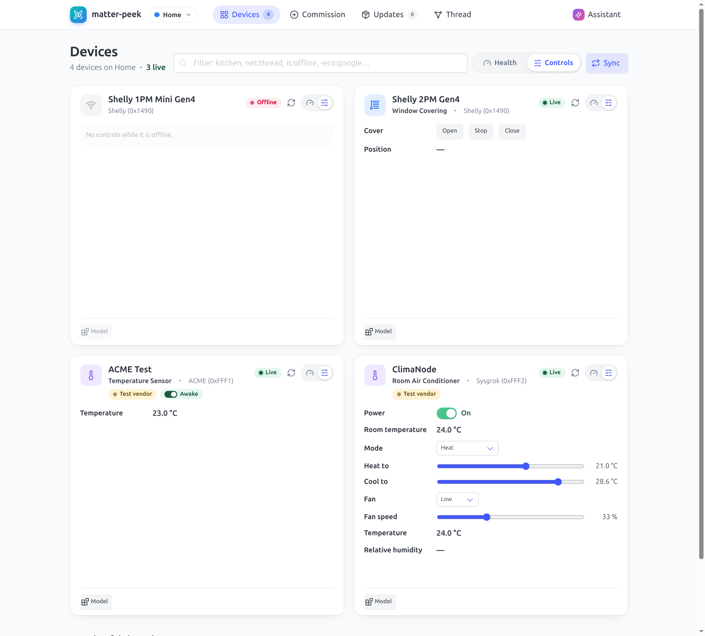
</picture>

## Commission

Devices can be commissioned over the network, or over Bluetooth LE onto Wi-Fi
or Thread. The setup code can be typed in, scanned with the camera or read from
a picture.

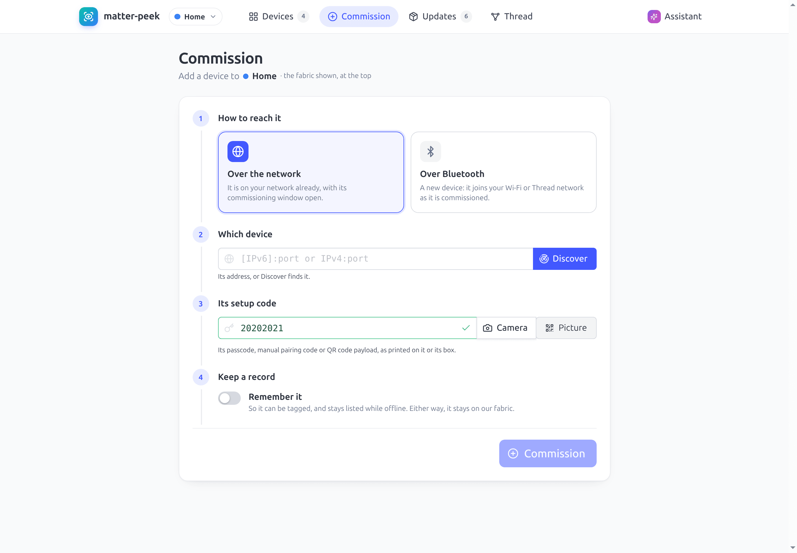

## Updates

matter-peek acts as the OTA Provider for the devices. When you add an image, the
devices it is meant for are offered the update.

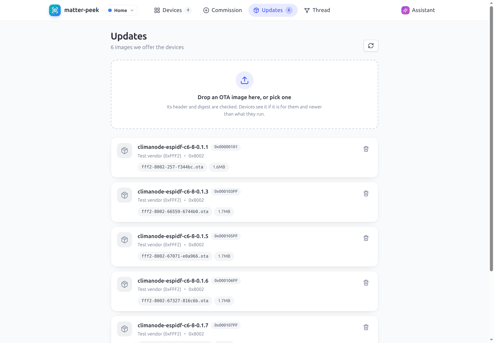

## Thread

This page shows the Thread mesh, put together from what the Thread devices
report over Matter. It shows the networks, a map of the links, every node, and
the problems that were found.

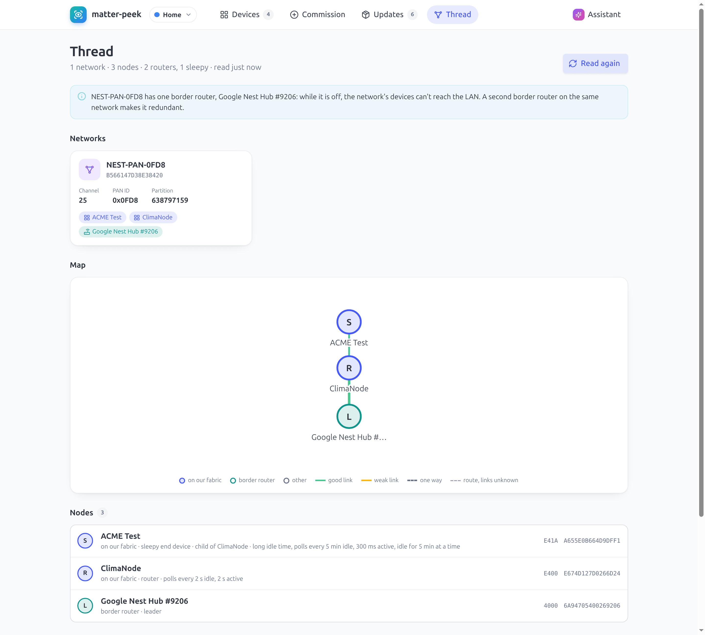

## Assistant

You can ask questions in plain words. The model of your choice, here a local
one on Ollama, uses matter-peek's tools to look into the devices and answers.
It does not change anything without your approval.

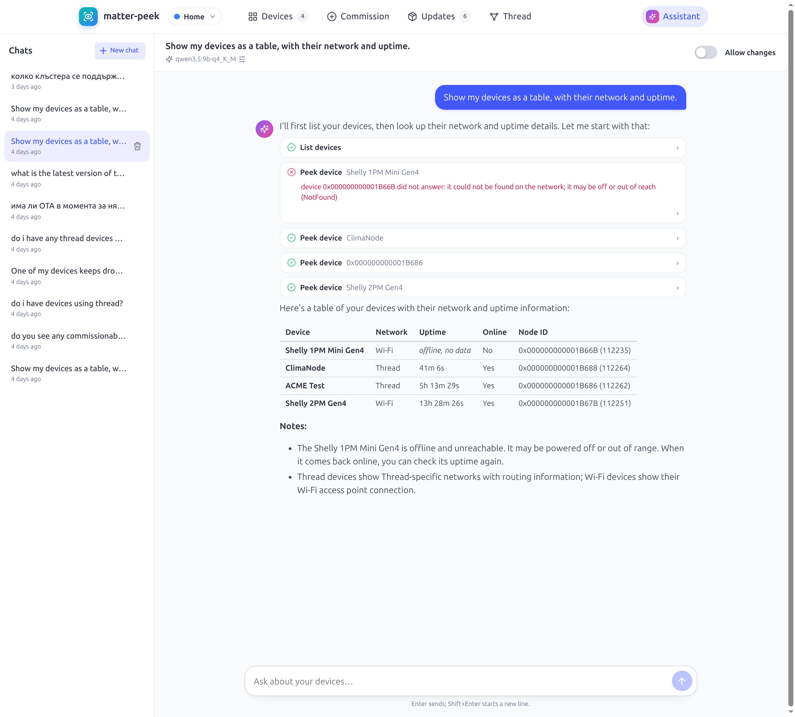

## Data model

This shows every endpoint, cluster, attribute, command and event of a device,
updated live, together with the controls.

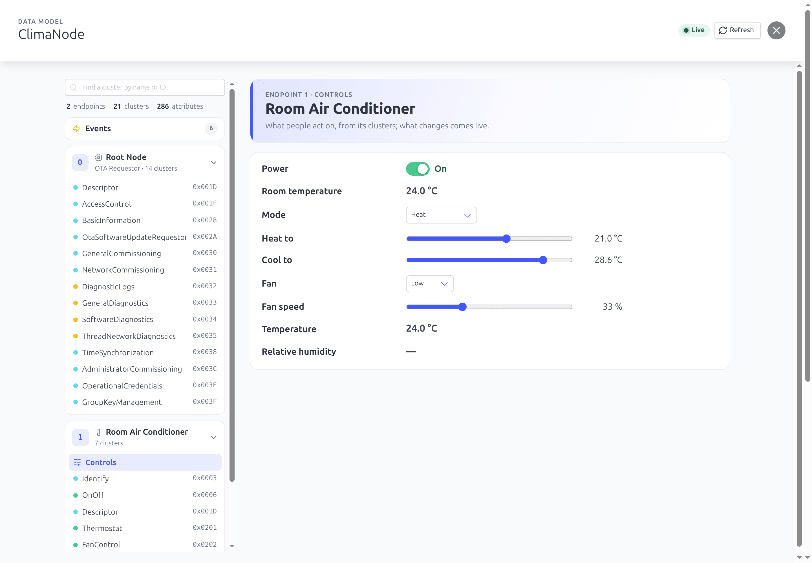

## Network

This shows a device's networks and interfaces, and its Thread neighbours with
their signal and error rates.

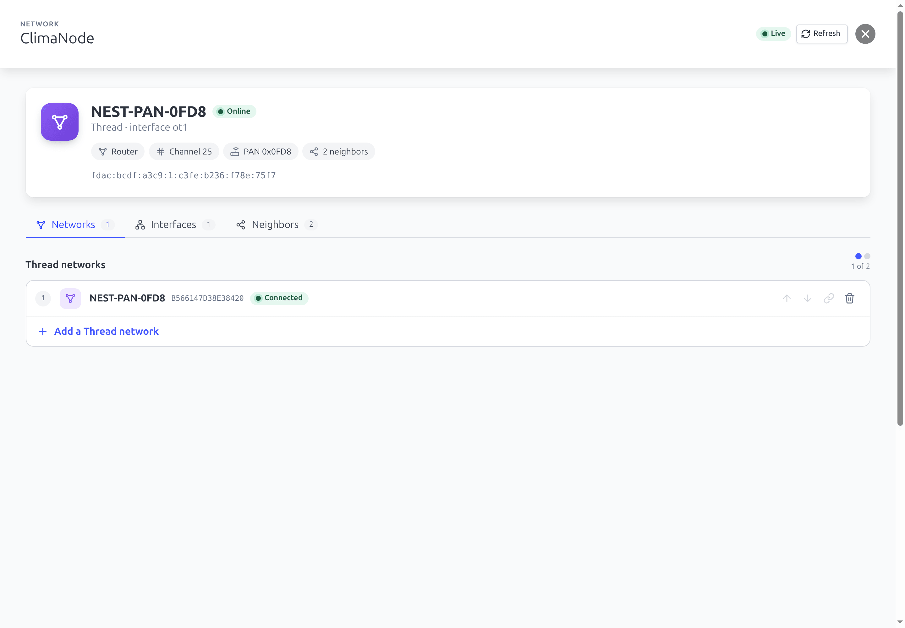

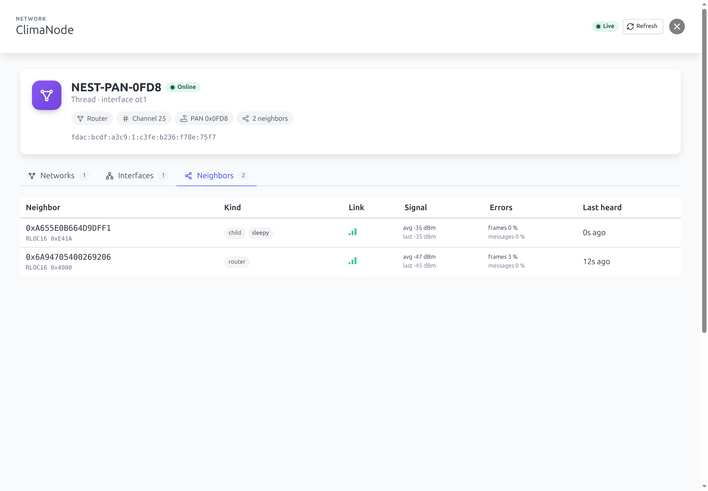

## Logs

These are the diagnostic logs a device keeps, retrieved over BDX: the end-user
support log, the network diagnostics log and the crash log.

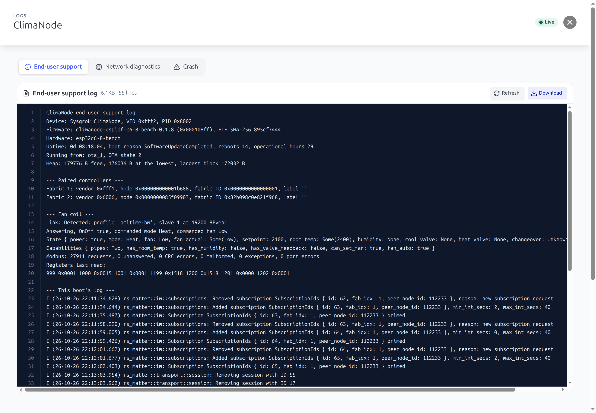

## Memory

This shows the device's heap, and how close each task came to the end of its
stack.

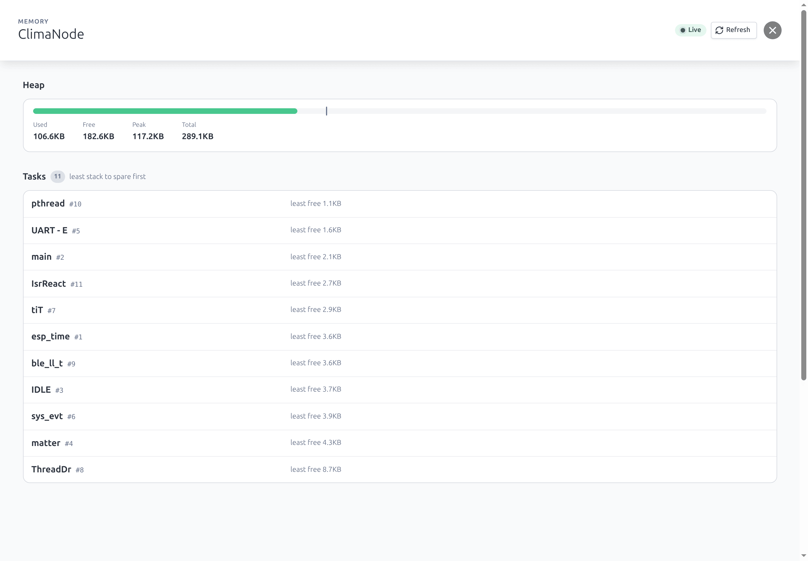

## Fabrics and sharing

This shows the controllers a device belongs to, and a commissioning window for
adding the device to another app.

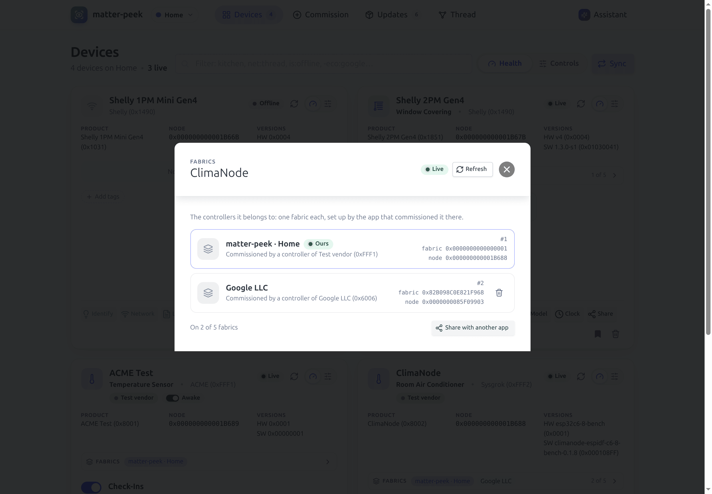

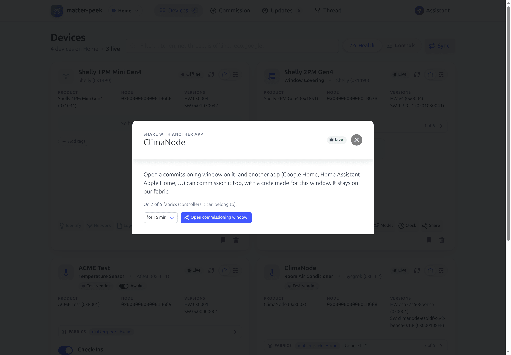

## Clock

This shows the device's UTC time next to ours, where the device gets its time
from, and a button to set it.

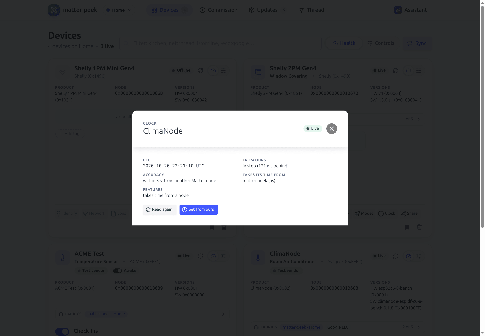
